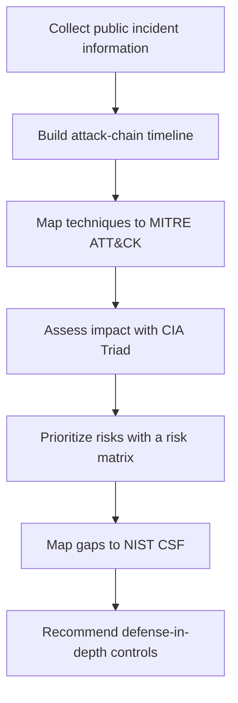

# Asahi Brewery Cyberattack - Case Study & Risk Assessment

**Academic team project | February–March 2026**

## Overview

This project studies the 2025 ransomware incident affecting Asahi Group Holdings. It organizes information from public reporting and threat-intelligence references into an attack-chain analysis, maps relevant techniques to MITRE ATT&CK, evaluates impact using the CIA Triad, and proposes risk-reduction measures aligned with NIST Cybersecurity Framework concepts.

**Scope clarification:** The submitted project report is primarily a research-based case study. Its limitations section states that a full real-world attack simulation was not performed and that some parts of the analysis rely on public information or assumptions because internal evidence was unavailable. This repository therefore does not claim to reproduce Asahi's production environment or the complete incident.

## Project objectives

- Describe the incident context and business impact.
- Organize the intrusion into key stages, from reconnaissance and initial access to execution, lateral movement, and ransomware impact.
- Map relevant behaviors to MITRE ATT&CK technique IDs.
- Assess confidentiality, integrity, and availability impacts using the CIA Triad.
- Build a risk matrix and map security gaps to NIST CSF functions.
- Propose layered technical and organizational controls.

## Analysis workflow

## Attack-chain themes examined

| Stage | Behaviors discussed in the report |
|---|---|
| Reconnaissance | Public information gathering and target profiling |
| Initial access | Spear-phishing and credential abuse |
| Execution | Malicious file execution and PowerShell activity |
| Lateral movement | Remote administration activity, including SMB/PsExec and RDP |
| Impact | Data exfiltration, ransomware encryption, and disruption of operations |

The report's MITRE ATT&CK mapping discusses techniques including `T1566.001`, `T1566.002`, `T1078.002`, `T1204.002`, `T1059.001`, `T1547.001`, `T1053.005`, `T1003.001`, `T1021.001`, `T1021.002`, `T1562.001`, `T1490`, `T1041`, and `T1486`. These are presented as an analytical mapping based on sources referenced in the report; they should not be read as a claim that the project independently collected forensic evidence for every technique.

## Risk assessment and recommendations

- **CIA Triad:** Confidentiality, Integrity, and Availability.
- **Risk Matrix:** qualitative assessment of likelihood and impact.
- **NIST CSF:** organizing gaps and recommended security improvements.
- **Defense-in-Depth:** five recommended layers:
  1. Endpoint protection (EDR / antivirus).
  2. Network protection (firewall, IDS/IPS, segmentation).
  3. Identity protection (MFA, privileged access management, least privilege).
  4. Monitoring (centralized logging, SIEM / SOAR, threat intelligence).
  5. Recovery (immutable and offline backups, disaster recovery planning).

These are recommendations from the academic analysis, not controls deployed inside Asahi's environment by the project team.

## Technology and frameworks

- VMware, Kali Linux, Windows 10 (listed in the project toolset)
- Metasploit (listed in the project toolset)
- MITRE ATT&CK
- NIST Cybersecurity Framework
- CIA Triad and a 5×5 risk matrix

## Team and personal contribution

**Team project.** The submitted report lists Tiêu Hoàng Phúc, Nguyễn Nam Trường, and Nguyễn Phú Đạt.

**My role — Team Lead & Primary Contributor:** Led the project work and handled the case-study research and analysis deliverables, including the attack-chain breakdown, MITRE ATT&CK mapping, CIA Triad assessment, risk matrix, NIST CSF mapping, and Defense-in-Depth recommendations. The submitted report also credits the other team members; this was a team academic project. The security controls described are proposals, not controls deployed at Asahi.

## Limitations

- The analysis relies primarily on public sources rather than Asahi's internal forensic data.
- Some details are analytical assumptions because complete internal evidence is unavailable.
- The report explicitly notes that a full attack simulation was not performed.
- Findings and technique mappings should be interpreted in the context and scope of the academic report.

## Safety and responsible use

This repository is for academic security analysis and defensive learning. Do not use attack-chain descriptions to target systems. Any hands-on testing must be performed only in an isolated lab and on systems for which you have explicit authorization.
