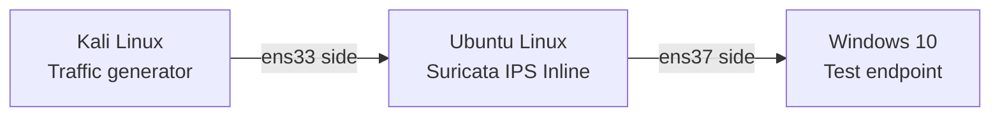

# Ransomware Detection & Prevention with Suricata (IDS/IPS)

**Academic lab project | September–November 2025**

## Overview

This project builds an isolated three-VM network lab to detect and block selected ransomware-like network behaviors with Suricata. Suricata is deployed in **IPS Inline mode using AF-PACKET** so traffic can be inspected and matching traffic can be dropped before reaching the Windows test endpoint.

The lab focuses on three observable behaviors: suspicious HTTP downloads of executable/install packages, repeated SMB file-write activity, and unusual DNS queries that may resemble beaconing.

## Lab topology

- **Kali Linux:** generates controlled test traffic inside the isolated lab.
- **Ubuntu Linux:** runs Suricata and inspects traffic across two interfaces (`ens33` and `ens37`) in AF-PACKET IPS mode.
- **Windows 10:** receives forwarded traffic and is used as the test endpoint.

> Interface names and IP addresses are specific to the original VM setup. Adapt them before reusing any configuration.

## Technology stack

- Suricata IDS/IPS
- Ubuntu Linux, Kali Linux, Windows 10
- VMware
- AF-PACKET (IPS Inline)
- Suricata rules, PCAP analysis, Windows Event Viewer

## Detection scenarios

| Scenario | Detection focus | Intended response |
|---|---|---|
| Suspicious HTTP download | `.exe` / `.msi` indicators in HTTP requests or URIs | Alert; selected traffic may be dropped in IPS mode |
| SMB write burst | Repeated SMB write activity that may indicate mass file modification | Alert or drop, depending on the rule |
| DNS beacon-like query | Long, random-looking DNS labels | Alert for investigation |

The rule examples use options such as `content`, `pcre`, `flow`, `threshold`, `sid`, and the `alert` / `drop` actions. See [the example rules](rules/ransomware.rules.example) and [AF-PACKET configuration fragment](configs/af-packet-inline.example.yaml).

## Monitoring and validation

The team tested the rules with simulated traffic and PCAP data. Analysis correlated Suricata output (`fast.log` and `eve.json`) with Windows Event Viewer records, including event IDs `4688`, `4663`, and `7036`, to build an incident timeline.

The academic report records successful detection of the main behaviors in the defined lab scenarios. It also notes that the rule set is limited in scope and that additional tuning is needed to reduce noisy DNS alerts and improve coverage. **The reported results apply only to the test cases; they are not a claim of 100% detection against all ransomware or production networks.**

## Reproducing the lab

1. Create three VMs in VMware: Kali Linux, Ubuntu Linux, and Windows 10.
2. Configure the Ubuntu VM with two network interfaces so it can inspect traffic between the test-traffic VM and the Windows endpoint.
3. Install Suricata on Ubuntu and configure AF-PACKET IPS Inline mode for the two lab interfaces.
4. Configure the protocol port groups used by the lab (HTTP: `80, 8080`; DNS: `53`; SMB: `445, 139`; TLS: `443`).
5. Add local rules after adapting destination addresses and validating rule syntax for your Suricata version.
6. Validate the configuration and generate only benign/safe test traffic or use sanitized PCAP files on an isolated network.
7. Review Suricata logs and Windows Event Viewer records, then document each test case and result.

This portfolio page contains configuration/rule examples, not a complete `suricata.yaml` or VM image. Add sanitized screenshots and verified lab configuration before presenting the project as fully reproducible.

## Limitations and next steps

- Controlled academic lab; not a production deployment.
- Detection coverage is limited to the HTTP, SMB, and DNS patterns tested.
- False-positive tuning and broader rule coverage are required.
- Future improvements include expanded rules and SIEM / EDR integration.

## Team and personal contribution

**Team project.** The submitted report lists Tiêu Hoàng Phúc and Nguyễn Phú Đạt.

**My role — Team Lead & Primary Implementer:** Led the project and was responsible for the lab implementation workflow, including the three-VM topology, Suricata AF-PACKET IPS Inline setup, custom HTTP/SMB/DNS rule development, controlled test execution, and review of Suricata and Windows event logs. The submitted report also credits the other team member; this was a team academic project.

## Safety notice

All tests must be performed in an isolated lab or on systems for which you have explicit authorization. Do not upload live malware, weaponized payloads, credentials, private network details, or PCAP files containing personal or organizational data.
